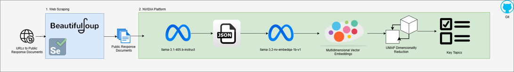

# AI Guardrails: Extracting Insights from Public Submissions

> **Turning unstructured consultation responses into structured, discoverable evidence.**

This project was developed during the **NVIDIA Generative AI Codefest**. It applies large language models (LLMs), text embeddings, clustering and dimensionality reduction to identify recurring concerns in public submissions about **mandatory guardrails for AI in high-risk settings**.

The goal was not simply to summarise documents one by one. We wanted to make patterns across a large collection of submissions easier to inspect: what people were concerned about, what risks they identified, what they proposed, and how those concerns related to one another.

---

## The achievement at a glance

| 226 | 1,118 | 6 |
|:---:|:---:|:---:|
| **Submissions analysed** | **Concern statements embedded** | **Thematic clusters identified** |

The notebook's saved outputs contain 226 structured submission records and 1,118 concern-level embedding records. The six clusters provide a high-level map of the issues raised across the material.

### From documents to themes

This is the implemented analytical path represented in the final workflow notebook. The presentation also records vector search and retrieval-augmented generation (RAG) as part of the initial strategy; the final notebook supplied here focuses on LLM extraction, embeddings, K-means and UMAP rather than implementing a RAG retrieval layer.

---

## What problem were we solving?

Governments and businesses receive large volumes of unstructured feedback through consultations, surveys and submissions. Important themes can be difficult to identify consistently when responses are read or summarised individually.

The project focused on submissions to the Australian Government consultation on the safe and responsible use of AI in high-risk settings. The consultation received more than 300 submissions, with 279 made publicly available. Our project collected and analysed **226 documents** from a range of entities.

We set out to demonstrate how generative AI could help turn this material into structured information that can be explored and compared, with greater transparency, testability and flexibility than a collection of free-form summaries.

## What we built

The workflow combines two complementary techniques:

1. **LLM-based extraction** converts each submission into structured fields that can be analysed programmatically.
2. **Embedding-based analysis** represents individual concerns as vectors, groups semantically related concerns, and projects them into a two-dimensional visual space.

The result is a structured dataset and an interactive UMAP view in which each point represents an extracted concern. Points are coloured by their K-means cluster, and the interactive plot supports inspection of the underlying theme text.

## Methodology

### 1. Prepare the submission corpus

The final notebook loads a processed CSV containing submission text. The key input fields are:

- `URL_ID` — identifier for the source submission.
- `Owner` — source/submitter field carried in the input.
- `Raw_Scraped_Text` — submission text supplied to the LLM.

The notebook fills missing `Raw_Scraped_Text` values with empty strings before processing. Web scraping and the upstream creation of this processed dataset are described in the presentation, but are not implemented in the supplied final workflow notebook.

### 2. Extract structured insights with an LLM

Each submission is passed to NVIDIA's API using the OpenAI-compatible Python client. The final notebook uses:

- **Inference model:** `meta/llama-3.1-405b-instruct`
- **Temperature:** `0`
- **Output:** JSON requested through the prompt

For each submission, the prompt asks the model to extract:

| Field | What it captures |
|---|---|
| `topics` | Topics mentioned in the submission |
| `concerns` | Concerns raised by the submitter |
| `risks` | Risks outlined in the text |
| `proposals` | Proposals put forward |
| `requests_to_consider` | Requests for consideration |
| `sentiment` | Overall sentiment: very negative, negative, neutral, positive or very positive |

The prompt also instructs the model not to include personal names, email addresses or company names. The model is asked to return only JSON, with arrays for the extracted items and a sentiment value.

This structured output is the bridge between natural-language analysis and conventional Python data processing. Instead of leaving the findings in prose, we can store, filter, inspect and transform them using familiar data structures.

### 3. Generate concern embeddings

The workflow then focuses on the extracted `concerns` field. Individual concern statements are sent to NVIDIA's embedding endpoint using:

- **Embedding model:** `nvidia/llama-3.2-nv-embedqa-1b-v1`
- **Input type:** `passage`

Each embedding is retained alongside its original theme text, submission ID and within-submission identifier. The saved notebook output contains **1,118 concern-level records**.

This representation allows semantically similar statements to be compared even when submitters use different wording.

### 4. Reduce the embeddings to two dimensions

The high-dimensional vectors are projected into two dimensions with UMAP:

| Parameter | Value |
|---|---:|
| `n_neighbors` | 30 |
| `min_dist` | 0.0 |
| `random_state` | 42 |

UMAP makes the embedding space easier to visualise. Each point in the plot corresponds to one extracted concern; nearby points represent concerns that are closer in the learned embedding space. The two axes are projection coordinates, not policy measures or scores.

### 5. Identify thematic clusters

K-means is applied to the original embedding vectors. The notebook explores candidate cluster counts from 1 to 20 using an elbow plot, then fits a six-cluster solution (`n_clusters=6`, `random_state=81`).

The resulting cluster labels are added to the UMAP coordinates and concern text. This lets the visualisation show both the broad grouping and the underlying language that informed it.

### 6. Explore the result interactively

The final notebook uses **Bokeh** to create an interactive scatter plot titled *AI Guardrails Themes*. Points are coloured by cluster, and hover tooltips expose the cluster label and extracted theme.

This was the practical deliverable chosen during the event. The original ambition was a broader interactive dashboard (for example, Streamlit or Power BI), but the team narrowed the scope to an interactive UMAP visualisation so that the core analytical result could be delivered within the available time.

---

## What the analysis surfaced

The six clusters were interpreted and labelled as follows in the final presentation:

| Cluster | Theme | Key ideas surfaced |
|:---:|---|---|
| **0** | Regulation policy | Regulatory frameworks and international alignment |
| **1** | Risks | Transparency, bias, data quality and model use |
| **2** | Ethics, society and legal | Human rights, privacy and cultural vulnerabilities |
| **3** | Regulatory enforcement | Standards, requirements and protections |
| **4** | Harms | Bias, misuse and impacts |
| **5** | Regulatory burden | Over-regulation and the cost of compliance |

These labels are the team's interpretation of the resulting clusters, not categories supplied to the model in advance. The clustering provides a way to organise and explore the extracted concerns; it does not, by itself, establish the prevalence, severity or public representativeness of each theme.

## Visualising the achievement

### The six-cluster UMAP map

The following figure is the cluster-coloured UMAP scatter plot saved in the final notebook. Each dot represents one extracted concern statement. Colour indicates its K-means cluster.

*The two-dimensional layout is a projection of the embedding space. Interpret the broad groupings and inspect the underlying text; do not interpret axis values as quantitative policy scores.*

### Choosing the number of clusters

The notebook also evaluates K-means solutions across a range of cluster counts using within-cluster sum of squares (inertia).

### The result in one sentence

**We moved from 226 lengthy submissions to a structured collection of extracted insights and 1,118 embedded concerns, then organised those concerns into six interpretable themes that can be explored visually.**

---

## Technology

| Component | Technology used in the supplied workflow |
|---|---|
| Data preparation | Python, pandas |
| LLM inference | NVIDIA API, OpenAI-compatible Python client |
| Topic and concern extraction | `meta/llama-3.1-405b-instruct` |
| Embeddings | `nvidia/llama-3.2-nv-embedqa-1b-v1` |
| Dimensionality reduction | UMAP (`umap-learn`) |
| Clustering | scikit-learn K-means |
| Interactive visualisation | Bokeh |
| Supporting visualisation | Matplotlib |

We used NVIDIA APIs for inference and embeddings. The team also explored setting up and running NVIDIA NIMs with Docker, but **NIM deployment was not used in this implementation**.

## Repository contents

The repository contains a number of files used to consolidate the submissions, extract the key themes and cluster. The visual assets are exported from relevant notebooks so the key result can be viewed directly on GitHub without running the notebooks themselves.
  
## Limitations and lessons learned

- **Structured output:** The NVIDIA model endpoint did not expose the `response_format=json_schema` option in the OpenAI-compatible integration used by the team. We therefore specified the required JSON structure in the prompt and parsed the response in Python.
- **Privacy filtering:** We encountered issues using NeMo Curator to remove personal information such as names and company names. The team addressed this in the short-term by strengthening the main extraction prompt. This is a prompt-level mitigation, not a guarantee of complete de-identification.
- **Model selection:** Different models produced materially different outputs for the same prompt. We assessed alternatives and selected the model that gave the most suitable outputs for this use case.
- **Interpretation:** LLM extraction and unsupervised clustering can introduce omissions, inconsistent labels and grouping errors. Cluster labels require human interpretation and should be validated against source submissions before being used for consequential decisions.
- **Scope:** The final deliverable is an analytical proof of concept and interactive visualisation, not a production-ready dashboard or deployed service.

## Next steps

Several opportunities to further develope the process include:

1. Improve structured-output reliability with native JSON Schema response formatting and validation.
2. Strengthen privacy handling beyond prompt instructions, including more reliable personal-information detection.
3. Evaluate model behaviour systematically across representative submissions and extraction fields.
4. Improve cluster interpretation and validation with subject-matter review.
5. Extend the visualisation into a fuller dashboard for filtering, document-level drill-down and exploration of topics, risks, proposals and sentiment.
6. Continue development towards a reusable service for analysing unstructured client feedback.

## Acknowledgement

This work was completed in part at the **Generative AI Codefest, Australia**, part of the **Open Hackathons** program. The authors would like to acknowledge **OpenACC-Standard.org** for their support.

I aknowledge that project was completed as part of a broader team. This repository has been copied for the purposes of showcasing the accomplishment as part of my portfolio.
